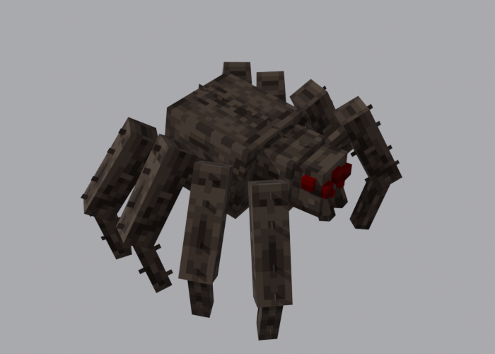

<div align="center">

# MODE MOB

**Новые существа для Minecraft — начиная с гигантского тарантула**

<br />


</div>

<br />

## О моде

MODE MOB добавляет в мир новых существ с собственными анимированными моделями и поведением.

Мод из серии MINECRAFT-MODE: худ и лечение — [MINECRAFT-MODE-HUD](https://github.com/KUZURAKI/MINECRAFT-MODE-HUD), транспорт — [MINECRAFT-MODE-TECH](https://github.com/KUZURAKI/MINECRAFT-MODE-TECH), тёмный персонаж — [MINECRAFT-MODE-DARKLORD](https://github.com/KUZURAKI/MINECRAFT-MODE-DARKLORD). Каждый мод работает сам по себе.

## Гигантский тарантул



| Параметр | Значение |
| --- | --- |
| Здоровье | 220 |
| Урон | 10 |
| Появление | Верхний мир, ночью и в темноте, вместе с обычными пауками, но гораздо реже |
| Добыча | 4–10 нитей и 2–5 паучьих глаз |

- Вокруг тарантула появляется стая из 8–15 пауков и пещерных пауков и 40–70 паутин.
- Заметив игрока, он переходит на быстрый бег.
- Стреляет паутиной: попадание сильно замедляет и оставляет паутину на месте.
- Анимации покоя, ходьбы и атаки.

Яйцо призыва лежит во вкладке творческого режима «Яйца призыва».

## Установка

1. Установите **NeoForge 1.21.1** (версия 21.1.x).
2. Скачайте `modemob-0.1.0.jar` и положите в папку `mods` вашей игры.
3. Запустите игру.

## Настройки

Файл `config/modemob-common.toml` создаётся после первого запуска: `spawnRarity` — насколько редко появляется тарантул, чем больше, тем реже.

## Сборка

```bash
./gradlew build
```

Готовый файл появится в `build/libs/modemob-0.1.0.jar`. JDK 21 Gradle скачает сам.

<br />

<div align="center">

Сделано **ZEDKODEX**

</div>
